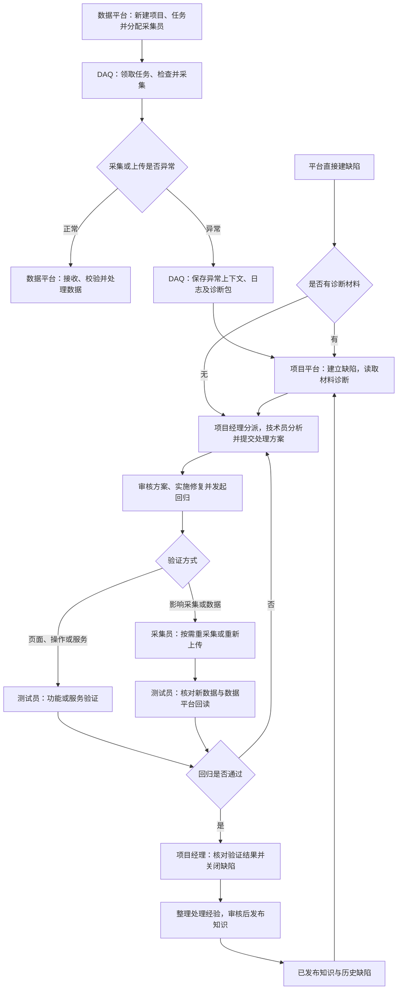

# EngramProject 项目管理平台

用于项目、研发和测试协作，管理需求、任务、版本迭代、测试用例、测试计划、缺陷、文档与知识。支持采集问题上报、外部账号登录集成、AI 问答和项目统计，界面以中文为主，统一使用中国标准时间。

代码助手请先阅读 [AGENTS.md](AGENTS.md)。

## 项目结构

```text
EngramProject/
├── ProjectFront/              # 主应用前端、页面与前端测试
├── ProjectServer/             # API、业务逻辑、数据库迁移与后端测试
├── services/                  # 配套服务
│   ├── diagnostic-agent/      # 隔离的诊断 Agent
│   ├── embedding-service/     # 中文知识向量服务
│   ├── document-ocr/          # 可选图片文字识别
│   ├── collaboration/         # 实时文档协作
│   ├── admin/                 # 实例管理界面
│   ├── space/                 # 共享内容访问界面
│   └── proxy/                 # 网关
├── packages/                  # 共用组件、编辑器、状态、类型和国际化
├── tests/                     # 跨平台验证、诊断评测与压力验收工具
├── deploy/                    # 当前镜像构建、环境模板及开发/测试部署配置
│   ├── release/               # 分层发布、安装、日志与中文部署说明
│   └── network/frp-bridge/    # 按需使用的frp连接程序和配置
├── deployments/               # 其他部署方式，部分仍被 CI 引用
├── scripts/                   # 配置初始化与回归检查工具
├── docs/                      # 开发说明、设计记录和许可说明
├── start.sh                   # 启动已构建的本机平台
├── stop.sh                    # 停止本机平台，保留数据
├── package-offline.sh         # 一键生成部署包、镜像包和可选frp包
├── docker-compose.yml         # 服务定义，日常启动使用 start.sh
├── package.json               # 项目命令
└── README.md                  # 项目入口说明
```

根目录中的依赖锁文件、工作空间配置和构建配置用于安装与编译；开发说明、历史设计和辅助部署文件统一放在对应子目录。 验证工具入口见 [tests/README.md](tests/README.md)，部署目录职责见 [deploy/README.md](deploy/README.md)，文档导航见 [docs/README.md](docs/README.md)。

## 技术栈

| 部分         | 技术                                                      |
| ------------ | --------------------------------------------------------- |
| 主前端       | React 18、TypeScript、React Router 7、Vite 8              |
| 页面与状态   | Tailwind CSS 4、MobX、共用组件和富文本编辑器              |
| 后端         | Python 3.12、Django 5.2、Django REST Framework            |
| 数据与任务   | PostgreSQL、Valkey、RabbitMQ、Celery                      |
| 文件存储     | S3 兼容对象存储与项目附件                                 |
| 实时协作     | Node.js、WebSocket、Yjs / Hocuspocus                      |
| 诊断 Agent   | Pydantic AI；项目平台运行，结合规则、日志与知识分析异常   |
| 知识向量     | BGE-small-zh-v1.5；独立 CPU 服务，用于相似知识检索        |
| 可选文字识别 | Tesseract、Poppler；本地候选转写，人工核对后导入草稿      |
| 可选通道     | frp；公网服务器与一台可联网采集电脑部署，连接内网数据平台 |
| 构建与部署   | pnpm 11.10、Turborepo、Docker Compose v2                  |

具体依赖版本以锁文件和 `ProjectServer/requirements/` 为准。可选OCR的部署与核对流程见[图片文字识别](services/document-ocr/README.md)。独立向量服务的模型准备与部署见[Embedding部署说明](services/embedding-service/README.md)。

## 发布与部署

发布分为三个独立产物：业务部署包、低频运行镜像包、可选frp包。日常业务更新只替换部署包，目标镜像版本匹配时继续复用；BGE权重随低频依赖交付，初始知识随业务部署包交付，只用于首次数据库初始化；后续升级不再导入，安装后的知识与配置独立保留。

```bash
./package-offline.sh --artifact all --build --output /绝对路径/交付目录
```

frp产物位于交付目录的 `optional/frp/`，普通内网部署无需启动。安装、升级、日志导出和失败恢复见[部署说明](deploy/release/部署说明.md)。

## 页面入口

项目内分别使用“需求”和“任务”，跨项目综合列表叫“工作总览”。右上角头像 → 设置是统一管理入口；成员与权限集中在一张人员表中，可为同一人员选择工作空间、项目并分别设置岗位。平台连接填写类型、地址和必要凭据，其他参数在高级设置中维护。DAQ 上报可选择目标项目，自动关联数据平台的项目和任务。测试区负责用例、计划、执行记录和测试资源，发布验收归入版本迭代。入口和操作说明见[部署说明](deploy/release/部署说明.md)。

## 本地开发构建与启动

以下开发命令面向完整源码。交付部署包使用已编译产物，安装和升级按包内《部署说明》执行，无需在目标服务器编译；随包保留的开发、测试记录用于查阅。

### 前置要求

- Node.js 22.18 或更新版本、pnpm 11.10
- Python 3，用于初始化本地配置
- Docker 和 Docker Compose v2

### 首次构建

在项目根目录执行：

```bash
# 生成本项目的本地配置，不覆盖已有文件
python3 scripts/init_local_config.py

# 安装依赖、编译应用并构建本项目镜像
./deploy/build.sh

# 启动已构建的服务
./start.sh
```

默认入口：**http://localhost:18890**，仅监听本机。首次访问按页面提示完成实例与管理员初始化。

首次启用内置知识检索，执行 `python3 services/embedding-service/setup_platform.py --apply --download-model --build-image`；已有模型和镜像时只需 `--apply`。平台自动连接向量服务，页面只需配置问答模型。参数及离线安装见[部署说明](services/embedding-service/README.md)。

`start.sh` 只启动已有镜像，不编译代码、不构建或拉取镜像。停止服务使用：

```bash
./stop.sh
```

配置位于 `deploy/local/.env`。该文件包含本机生成的随机密钥，不提交到 Git；重复初始化会保留原文件。数据库、对象存储和诊断附件使用本项目独立的数据卷，停止服务不会删除数据。

本机部署采用固定版本的运行基础镜像，叠加当前源码和编译产物。完整源码镜像构建文件仍位于各应用目录，供正式构建流水线使用。

## 开发步骤

### 前端

```bash
# 在项目根目录安装整个工作空间的依赖
pnpm install --frozen-lockfile

# 启动主应用开发服务器
cd ProjectFront
pnpm dev
```

默认开发地址为 `http://localhost:3000`。环境变量模板位于 `ProjectFront/.env.example`；API 和实时协作地址应指向同一开发环境。

### 后端及配套服务

后端代码位于 `ProjectServer/`，接口、业务逻辑和数据库迁移随对应模块维护。实时协作服务位于 `services/collaboration/`。

需要创建各应用开发配置时，在根目录执行：

```bash
./scripts/setup_dev.sh
```

脚本只创建缺少的配置，保留现有文件。开发服务定义位于 `deploy/dev/compose.yml`；后端依赖及调试方式见 [后端测试与环境说明](ProjectServer/tests/RUNNING_TESTS.md)。

## 可选网络连接

普通内网测试支持同机分容器或不同内网服务器直接连接数据平台。公网项目平台与内网数据平台需要通过专用受限通道互访时，可使用独立的 [frp连接包](deploy/network/frp-bridge/README.md)。它默认只检查配置，不自动安装服务、修改电脑网络或开放端口；启用后采集员仍在DAQ按原流程操作。

三种模式与隔离测试范围见 [部署连接验证](docs/design/three-platform/公网与内网部署验证.md)。

## 环境配置

- **本地部署**：`deploy/local/.env`，模板为同目录 `.env.example`。
- **前端开发**：`ProjectFront/.env`，仅把允许公开的前端参数写入 `VITE_` 配置。
- **后端开发**：`ProjectServer/.env`，配置数据库、缓存、消息队列及存储。
- **实时协作**：`services/collaboration/.env`，与 API 使用匹配的协作连接配置。
- **外部服务**：账号目录、采集客户端和 AI 模型连接由管理员在平台中配置。

源码不包含现有环境的用户数据、附件、数据库或服务凭据。复制代码不会自动切换已有运行服务。

## 数据库迁移

迁移文件保存在后端各业务模块的 `migrations/` 中。部署中的 `migrator` 服务执行 Django 数据库迁移，API 等待迁移完成后启动。

新增数据结构变更应追加迁移文件；已有环境升级前应备份数据库，并在隔离环境验证迁移。

## 检查与测试

在根目录依次执行：

```bash
pnpm check:platform       # 类型检查
pnpm build:platform       # 编译主应用与实时协作服务
pnpm test:frontend        # 前端回归
pnpm test:collaboration   # 实时协作测试
```

这些命令会构建或读取共用包，避免在同一目录并行执行多次编译。

后端隔离测试配置为 `deploy/test/compose.yml`，完整步骤见 [后端测试说明](ProjectServer/tests/RUNNING_TESTS.md)。测试使用独立数据库，不使用业务数据库。

## 主要功能

- **项目与成员**：管理员拥有全部岗位业务权限，经理分派审核，技术员修复，测试员验证，数采员上报；保留负责人和协作者分工。
- **需求与任务**：独立业务编号、状态流转、筛选、批量操作，以及列表、看板、表格、日历和时间线。
- **版本迭代**：版本范围、里程碑、时间轴和分叉汇合流程。
- **测试管理**：用例库、用例集、用例版本、计划与执行结果、发布检查。
- **缺陷管理**：提报、分派、处理、回归、关闭及重开，图片、附件与日志在线查看。
- **采集协作**：采集问题上报、诊断材料和补采回归。
- **知识与 AI**：知识整理、脱敏检查、审核发布、检索与会话问答；扫描文字可选本地识别，核对后生成草稿。
- **统计与通知**：按项目、人员和时间范围查看统计，通知跳转对应记录。

实际可见项目、菜单和操作由账号权限决定。模型与外部服务需完成配置后使用。

## 采集问题处理流程



录制文件上传至数据平台；项目平台只接收诊断材料。缺陷可由DAQ上报，也可在平台建立；有日志或诊断包时分析，无材料可直接处理。按实际影响选择功能或数据验证。

流程中的完整模拟进展与验证边界见[测试记录](docs/design/three-platform/本轮测试与遗留项.md)。

## 许可证

见 [LICENSE.txt](LICENSE.txt)、[版权声明](docs/legal/COPYRIGHT.txt)和[第三方与开源声明](docs/legal/THIRD_PARTY_NOTICES.md)。

诊断队列、并发与实现范围见[诊断实施记录](docs/design/agent-diagnosis/本轮实施记录.md)。
