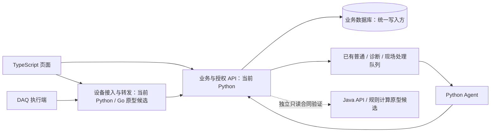

# 开源方案对比与平台重构方案

2026-11-20。工作分支：`feat/platform-architecture-performance-20261120`。

## 决策摘要

先建立模块边界，再判断是否拆成独立服务。当前确认保留 TypeScript 页面、Python 业务及 Agent；Go 是设备连接/转发层的原型候选，Java 是独立业务 API 或规则计算的原型候选，C 仅在需要底层协议组件时复用。Go、Java、C 都没有接入运行平台，不能把候选描述为已迁移。

本次已开发终端输出批处理优化，并在隔离 PostgreSQL/Redis 中验证。它说明当前首先存在可通过减少跨进程调用和重复查询解决的问题，不能据此判定 Python 必须重写，也不能证明所有 API 保持 Python 最优。

## 对比范围与可信度

调研分三组：项目管理、设备接入、任务调度。共 10 个仓库、9 个项目家族；JumpServer Core 与 KoKo 分别核查。读取官方 README、依赖和相关架构文档，固定下表提交。未搭建或压测竞品，以下为架构证据，不是竞品性能排名。默认开发分支不等于稳定发布版，也不照搬其依赖版本。

| 项目与官方快照 | 核查内容 | 可借鉴之处 | 不宜照搬之处 |
|---|---|---|---|
| [Plane](https://github.com/makeplane/plane/tree/18bdefae3379c6b9eea084045c2d134310ab19fb) | README、API pyproject；React Router、Django | 与当前平台接近，先优化既有接口、领域和查询边界 | 原项目不能证明本平台现场诊断链路的容量 |
| [OpenProject](https://github.com/opf/openproject/tree/8c1a979057b8e1da86d4aabe1587a548d3bd54b4) | Gemfile、前端 package.json；Rails 与 TypeScript 前端 | 成熟业务可保留动态语言，强模块边界和完整产品能力更关键 | 不因其用 Ruby 就给本平台再引入 Ruby |
| [Taiga](https://github.com/taigaio/taiga-back/tree/8ab6a4e3b5f6fbbfcbf108a6449011f07b7308aa) | README、requirements；Django 后端 | 项目/任务/缺陷可在单一业务后端维护 | 其 Django 版本不是本平台升级或降级建议 |
| [JumpServer Core](https://github.com/jumpserver/jumpserver/tree/0c71ca2164eda311430ee8ed899aab29fe2d1188)、[KoKo](https://github.com/jumpserver/koko/tree/a46d0cf592634abf147ea0f06d8b015abf9c16c2) | Python Core、Go KoKo；KoKo 明确支持 SSH/SFTP/Web 终端与文件管理 | 管理/授权与连接处理可以分工，连接服务遵循既有权限事实 | 不能未经会话、审计和设备身份适配就替换现有执行端 |
| [Teleport](https://github.com/gravitational/teleport/tree/1283425b60ec5f60d509ba4c791183d452923ff7) | go.mod、README 中 Auth/Proxy/资源接入职责 | 统一认证、代理接入与会话审计；Go 可用于连接层 | 完整接入平台远大于本平台需要，不作为自动新增依赖 |
| [Guacamole](https://guacamole.apache.org/doc/gug/guacamole-architecture.html)、[guacd 源码](https://github.com/apache/guacamole-server/tree/bb1ba8ed1414ec6a239cea265d4e9c7e23b9c6a3) | 官方架构、C daemon.c；Java Web、JS 客户端、原生协议代理 | 协议转换与 Web 业务分离，C 用于确实存在的协议职责 | 当前需求主要是 PTY/SSH；没有 RDP/VNC 需求就不引入整套 guacd |
| [authentik](https://github.com/goauthentik/authentik/tree/60f0506075a13bb21c25065fa8c60fb6993c1189) | Python 配置、Go module、outposts/proxy 目录配置 | Python 核心与 Go 组件可以协作，适合研究授权与接入边界 | 未完整审计其代理实现，不声称某段 Go 代码可直接移植 |
| [Temporal](https://github.com/temporalio/temporal/tree/a8f8328b001bd3302e658cdd062e18a5e92cf50f) | Go 服务端、官方工作流描述及多语言 SDK 链接 | 持久任务状态、故障恢复及任务/执行器分离 | 不把“重试任务”直接变成重复执行机器人修复；先复用现有 Celery |
| [DolphinScheduler](https://github.com/apache/dolphinscheduler/tree/253bd29ede556dadb5c5e3117f06b582eafb4fa7) | Java pom 模块 API/DAO/服务、README master/worker 描述 | Java 可承担任务服务，强调服务职责、恢复和资源隔离 | 完整工作流平台引入成本高，不为采用 Java 而替换已有队列 |

仅研究架构，本次未复制上述项目代码或集成其组件。将来复用时按实际文件/发行版核对许可；authentik 为分目录许可，Teleport 源码与发行产品也应分别核对，不能只看仓库语言或 API 的 license 字段。

## 语言优势与代价

| 语言 | 在本平台的优势 | 代价与限制 | 当前决定 |
|---|---|---|---|
| TypeScript | 浏览器生态、共享类型、现有组件和状态管理 | 资源体积、请求瀑布、主线程阻塞仍要优化 | 保留前端和现有协同服务 |
| Python | Django 事务/权限/ORM，现有业务与模型工具生态 | 同步 ORM/线程交接、CPU 密集计算及重复查询需控制 | 保留业务与 Agent，先改真实瓶颈 |
| Go | 标准库网络服务、并发连接处理、单二进制交付；适合独立接入层原型 | 增加网络跳转、协议与认证合同维护；并发不自动等于低延迟 | 候选：设备出站连接、终端与文件流转发 |
| Java | 类型契约、成熟事务与服务治理、便于大团队维护复杂 API；可评估独立规则模块 | JVM/JIT/GC、服务启动、内存与部署成本；重写 Django 权限/历史会有风险 | 候选：边界清晰的业务 API 或计算任务，先隔离对比 |
| C | 低层协议、系统库、编解码等场景可直接复用成熟实现 | 内存安全与跨平台构建成本，不能简化权限或事务业务 | 当前不新增；有明确协议需求再评估组件 |

Java“做接口”应区分提供 API 与调用外部 API。前者可因工程治理而适合 Java；后者若时间主要耗在数据库、模型或公网等待，改语言仍需要处理调用次数、连接复用、超时、重试和排队。

## 按职责重构，而非先拆微服务

当前 `remote_diagnostics.py` 同时含目录、会话、凭据、交换、Agent 任务和工具入口，约 965 行；`views.py` 约 1092 行，远程 runner 约 998 行。行数是检查信号，不是拆分收益证明。已有 remote_models、remote_tasks、remote_files、agent_lifecycle 等模块要复用，不再并行建立同义服务。

| 边界 | 负责 | 不负责 | 重构方向 |
|---|---|---|---|
| 业务与授权 | 用户、项目、任务、缺陷、权限、审计、公开回复、状态事务 | 长连接字节搬运、模型执行 | 先保持同进程/同一事务体系，分别明确目录/会话/任务应用接口与统一授权策略 |
| 设备接入与传输 | 身份绑定、心跳、连接、终端/文件字节、流量控制、断线恢复 | 自行放大权限、决定修复、直接改业务表 | 先稳定现有 Python 合同，之后用 Go 对照单个传输模块 |
| Agent 任务 | 证据、模型规划、受控工具请求、复测、失败移交 | 凭模型输出直接执行、不受约束重试、多个 Agent 争写同机 | 保留 Python 及专用队列，复用统一设备/任务互斥与执行授权 |
| 页面与读模型 | 摘要、列表、筛选、统计、进度、详细证据展示 | 重新计算一套状态/权限、把内部 ID 当用户正文 | 保留 TypeScript；接口提供统一摘要与按需详情 |

建议调用关系（设计，未部署）：

所有执行操作仍经唯一设备执行端校验，Agent 和未来 Go/Java 服务不能绕过原授权、目标版本及同机互斥。Go 不引入第二套账户权限库；Java 试验也不让两套 ORM 双写同一批业务表。

## 迁移顺序及停止条件

1. **基线和合同。** 记录页面、API、队列及双端传输分段耗时；固定分页、权限、任务状态、序号、幂等与错误合同。
2. **当前热点。** 减少重复查询/往返，修正输出原子性；已有终端批处理改动属于本阶段。先测同一语言能解决多少。
3. **代码边界。** 在相同 Python 运行进程内逐项分离授权策略、会话应用逻辑和 HTTP/WS 适配；每项保留原测试入口，不一次搬迁三个大文件。
4. **Go 单模块原型。** 只在隔离环境承接一条终端转发链路，比较原生链路和经 Go 链路。先保留原业务授权，不代理全部 API。验证顺序、断线、取消、背压、慢客户端和会话撤销。
5. **Java 单模块原型。** 选择有清晰合同的只读聚合 API 或独立计算任务，与优化后的 Python 比较。核心身份、权限和缺陷写入不作为首个重写目标。Java 客户端代理现有 Python 不等于 Java 重写，也不能算性能改进证据。
6. **采用决策。** 收益超过重复测试波动且故障恢复/维护代价可接受才接入；无收益则不引入该服务。设计分支不自动发布线上，不合入主分支。

Go/Java 需要共同覆盖冷/热启动、稳定负载和混合峰值，不只测 echo 或空接口吞吐。不以裁剪鉴权、降低存储可靠性、更大资源预算、放宽测试断言制造收益。原型只是候选，当前不承诺一定采用两门语言。

## 第一批改动与独立验证

当前改动仅位于 `ProjectServer/plane/quality/terminal_stream.py`：

- 空输出心跳跳过不必要的输出缓存查询；主设备交换认证仍执行。
- 同一批、同一会话只做一次权限与目标判断；下一批重查，不借用其他所有者的权限。
- 使用有上限的 Redis Lua 脚本，将同一会话序号分配与缓存追加保持原子；一批最多 100 条，缓存保留 8 块及原 60/120 秒 TTL。
- Redis 快速缓存仍属可选加速，持久事件和 HTTP/WS 的权限、顺序校验、缺口回退保留。

新增回归先复现四类问题：逐条 Redis 往返、4 个并发写入者缓存乱序、同一批 100 次重复权限判断、空输出仍查缓存。修正后覆盖跨所有者隔离、下一批撤权、缓存失效及可靠记录回退。

本轮独立回归 81 项通过，其中新增批处理合同 7 项通过；新增测试和测量脚本 Ruff 检查、Python 语法编译通过。隔离测试未提供静态资源目录的既有警告仍保留，不将本轮测试描述为整个仓库完整测试或前端验收。

测量为真实隔离 PostgreSQL 15.7/Redis 8、现有 Python 3.12.12/Django 5.2.15 测试镜像；API 测试容器 4核/4GiB，数据库 2核/2GiB，Redis 1核/256MiB。每组预热 10 次，保留 60 次样本，交替执行前后版本，两轮数据如下。测量包含该输出发布函数的数据库/权限路径，不包括公网浏览器、模型或真实采集电脑。

| 每批输出数 | 第1轮中位：原/新 | 第2轮中位：原/新 | 第2轮 P95：原/新 |
|---|---|---|---|
| 1 | 19.36 / 18.54ms | 17.12 / 17.01ms | 24.48 / 24.12ms |
| 8 | 42.06 / 19.67ms | 40.35 / 18.76ms | 53.54 / 25.67ms |
| 100 | 325.81 / 20.46ms | 390.94 / 23.87ms | 548.51 / 29.29ms |

单条几乎无收益，不能宣称所有交互都加速。批量收益主要来自避免按输出条数重复授权查询；只做 Redis 原子追加的初次试验未获明显整体改善，保留它的原因是修复已复现的并发顺序问题。

可运行验证入口：

- [批处理与权限回归](../../ProjectServer/plane/tests/contract/app/test_terminal_output_batch.py)。
- [显式配对测量](../../ProjectServer/plane/tests/performance/profile_terminal_output.py)。使用 `TERMINAL_BATCH_BASELINE` 指向从基线提交提取的 `terminal_stream.py`，`TERMINAL_BATCH_REPORT` 指向 artifacts 目录；显式 pytest 执行，不混入普通测试计数。
- [既有查询预算](../../ProjectServer/plane/tests/contract/app/test_remote_transport_query_budget.py)、[终端 WS](../../ProjectServer/plane/tests/contract/app/test_terminal_stream.py)、[站点 WS](../../ProjectServer/plane/tests/contract/app/test_station_stream.py)。

原始调研、错误与性能样本保存在本机 `/home/engram/Documents/tmp/artifacts/platform-architecture-research-20261120/`。第三方 HTTP 404 和浏览器启动失败均保留记录，已用实际可用源码入口核对依赖；不把工具失败算平台缺陷。

## 第二批改动：共享设备访问策略边界

在同一 Python 进程内抽出 [remote_access.py](../../ProjectServer/plane/quality/remote_access.py)，统一设备权限、身份指纹、在线判断、设备查找和浏览器写入来源校验。目录/会话/交换等 HTTP 入口继续留在 `remote_diagnostics.py`；文件、自动接入、Agent 任务/反馈/研究、诊断上下文和终端快速输出直接依赖公共策略，减少对视图模块的反向依赖。

本轮只建立这个边界，没有完成全部会话应用逻辑拆分。`remote_diagnostics.py` 保留原函数名的导入兼容，既有 HTTP/WS 路由、错误、事务、授权重查、缓存范围和序号协议保持。六个提取函数与提取前提交 `b9a1ff8` 的 AST 一致；代码换行不影响身份哈希的 JSON 顺序、分隔符或编码。未新增服务、依赖或数据库迁移，不作性能提升声明。

新增 [设备访问合同](../../ProjectServer/plane/tests/contract/app/test_remote_access.py) 23 项，覆盖管理员也必须具有当前项目/空间成员资格、归属技术员、设备/Agent/账户禁用、归档、身份指纹、20秒在线边界及 JSON/同源限制。独立解释器在禁止加载远程 HTTP 视图模块时仍可导入公共策略，防止重新引入反向依赖。

验证使用独立 PostgreSQL 15.7、Redis 8 和已有 Python 3.12/Django 5.2 测试镜像。新合同先因模块不存在失败，再与查询预算/批处理合同一起 35 项通过；扩大到终端、站点 WS、目录、接入、文件、队列及诊断上下文后 114 项通过、2 项按既有显式启用条件跳过（混合负载 broker、DAQ 源码挂载）。临时容器覆盖层绕过成员校验后，3 项撤权/归档测试如期失败，未修改工作树的授权策略。Django system check、Python 语法、Ruff 新文件检查及差异检查通过。

完整后端 `pytest` 实际执行 2882 项：2867 通过、5 跳过、9 失败、1 错误（628.91秒），不能声明全套通过。全部9失败和1错误已用提取前 `b9a1ff8` 源码覆盖层在同一隔离环境复现：分诊2项、成员上报1项、管理员继承1项、角色变更1项、验证范围4项；另有业务文件 `plane/quality/test_resources.py::test_scheduler` 被收集为测试后缺少 `project_id` fixture。未修改这些不相关代码或放宽断言。真实ZIP和种子挂载、测试URL、broker及附件目录的初期环境失败已单独保留日志，最终统计来自补齐环境后的完整运行。修改过的既有文件 Ruff 同配置基线202项、当前199项，无新增；这不等于整个项目 lint 无问题。

本轮证据保存在本机 `/home/engram/Documents/tmp/artifacts/platform-framework-boundaries-20261120/`。这属于模块边界回归，未部署平台、未验证真实设备或 Go/Java 原型。

## 官方机制依据

- [Redis pipelining](https://redis.io/docs/latest/develop/using-commands/pipelining/)：依赖前一次返回的读/改/写需要额外处理，不能把 pipeline 内部仍发起的独立请求算成合并。
- [Redis Lua 执行](https://redis.io/docs/latest/develop/programmability/eval-intro/)：脚本执行是原子的，也会阻塞 Redis，因此输入和保留量必须有上限；当前适配单实例 Redis，不声称新支持 Redis Cluster。
- [Django 5.2 异步](https://docs.djangoproject.com/en/5.2/topics/async/)：同步/异步切换与 ORM 事务有实际边界，不能仅改 `async def` 或提高 worker 数即宣称改善。
- [Channels 数据库访问](https://channels.readthedocs.io/en/stable/topics/databases.html)：保留连接清理与同步 ORM 适配，避免无约束线程/连接增长。

本轮不包含 Java/Go/C 的等价业务性能结论，不执行机器人动作，不连接 199，不修改 DAQ、主分支或生产部署。
