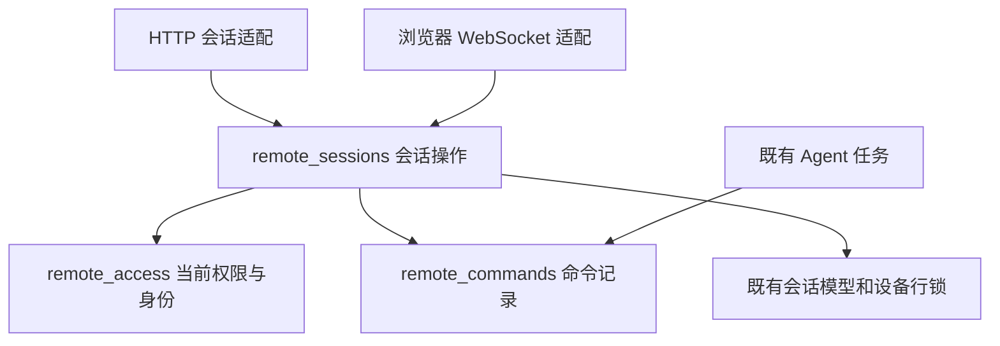

# 终端会话职责与事务边界

本批在独立优化分支拆出远程诊断应用边界，然后经验证合入 `feat/coverage-followups-152`。当前阶段不拆分数据库、任务队列或部署服务，不引入新的语言。

## 调整后的职责

| 模块 | 唯一职责与依赖 |
|---|---|
| `remote_access.py` | 当前设备权限、在线和身份策略；不依赖 HTTP 视图 |
| `remote_sessions.py` | 打开、读取、输入、缩放、关闭、会话失效与目标核验；不构造 HTTP 请求或响应 |
| `remote_commands.py` | 创建既有命令记录及有效期；会话和任务共用一个实现 |
| `errors.py` | 共享业务冲突异常；旧 `views.Conflict` 导入保持兼容 |
| `remote_diagnostics.py` | 会话部分只解析 HTTP 边界、调用应用函数、转换结果；原公开辅助导入保留兼容 |
| `terminal_stream.py` | 浏览器 WebSocket 序号、会话登录状态、消息和断线；直接调用同一会话应用函数 |

`remote_diagnostics.py` 中会话逻辑不再由 WebSocket 实例化 HTTP 视图来复用，省去构造 WSGI/DRF 请求及调用视图的依赖。设备交换也由 HTTP 和 WebSocket 直接调用 `exchange_station`，不再构造内部 WSGI 请求或调用 HTTP 视图。

## 事务与兼容性

- 打开会话在应用事务内重新读取并锁定设备，保留两会话上限、Agent/上传互斥、目标版本及尺寸校验。独立调用参数无效时不会留下会话或命令。
- 读取和修改使用相同设备锁与当前所有者检查。失效、撤权或超时导致的关闭在事务内返回结果，避免异常向外抛出后把关闭操作回滚。
- 关闭、最后输出、命令有效期和原积压阈值保持；本批不顺便修改业务限额。
- `SessionResult` 只是供两个适配器转换的结果，不依赖 Django HTTP 请求/DRF Response 对象。浏览器同源/JSON 检查仍在 HTTP 边界，WS Origin、顺序及注销校验仍在 WS 边界。
- 旧导入路径中的 `command`、`close_session`、`terminal_snapshot` 等仍指向同一实现，避免同时维护两份逻辑。

## 验证与性能口径

新增测试先复现“应用模块不存在、WebSocket 仍调用视图”的失败，再验证独立导入、HTTP/WS 同一命令、撤权关闭提交、无效打开回滚、并发开两会话限额及混合输入积压保护。

重构前后在同一隔离 PostgreSQL/Redis 和4核/4GiB测试容器中交替执行，预热8次后每版本60次样本。HTTP 读取查询数均为13；WS 应用路径读取中位约21.23→20.65ms、输入约21.30→20.25ms，P95约25→28ms。该差异处于波动范围，不能宣称重构带来明显加速或公网体验承诺。

本批收益是减少视图耦合、统一维护入口和明确提交边界。运行吞吐、线程、DB锁和网络瓶颈需要独立测量，文件数量或大小本身不是并发容量指标。原始运行记录在 `remote-session-boundary-20261120` 任务 artifacts；测试结果与部署证据另行记录，不用设计文字替代真实验收。

## 同批补全的应用边界

| 模块 | 职责 |
|---|---|
| `remote_exchange.py` | 验证设备凭据、锁定设备快照、接收心跳和回执、持久输出去重、过期清理、命令下发；HTTP/WS 同一入口 |
| `remote_directory.py` | 设备分页查询、登记与撤销、反馈摘要及原反馈目标查询 |
| `remote_bindings.py` | DAQ 签名反馈与原设备的绑定关系 |
| `remote_auth.py` | HTTP 的设备和 Agent 凭据适配 |
| `remote_run_requests.py` | 用户任务创建和读取，保留同设备串行和提交后投递 |
| `remote_run_state.py` | 排队进度、任务失效与回执事件 |
| `remote_tool_operations.py` | 工具策略校验、快照与权限复查、单次下发和有界等待；等待不占设备事务 |
| `remote_tasks.py` | Celery worker 获取设备执行权、模型调度、最终结果和原反馈回复 |
| `remote_file_operations.py` | 文件请求、上传票据身份及目标绑定、当前权限检查和上传回执 |
| `diagnostic_redaction.py` | 与文件读取和 HTTP 视图独立的凭据脱敏；原导入路径继续导出相同函数 |

`remote_diagnostics.py` 与 `remote_files.py` 保留现有 URL 对应类和兼容公开函数导出，只有请求边界和响应转换。终端操作、设备交换、任务及文件业务模块不依赖该 HTTP 模块。授权在每次操作或批次重查，当前批次的权限复用不会跨请求、跨所有者。

本批不更换 Python/Django、事务数据库、Celery 或镜像，也不改变 DAQ 协议、业务限额或机器人修复授权。文件下载、终端与自动任务的互斥和失效逻辑按现有合同保留。

## 最终功能对照记录（2026-11-20）

- 原版 `0c7df00` 与本次版本在同一输入、独立同配置数据库/Redis下各88通过；48条归一化HTTP响应及会话/命令/票据/排队状态逐字段一致。原先缺少 `/daq` 挂载的零配置用例随后两版各1通过，实际走登录后授权入口、HTTP登记和Engine PTY；不把合成已登录身份当浏览器密码登录。
- 整库首轮2884通过/23失败/4跳过。更正隔离附件根目录和broker后最终2910通过/9失败/6跳过；9项均在原版同环境重现。失败涉及既有版本锁/负责人配置/已退役角色与人工验收合同，未删断言或放宽业务校验来消除失败。
- 4进程Engine、4用户、4终端持续60秒，反馈、真实文件上传下载、配置补丁和复查交错，4198次HTTP操作全部通过。4个完整RemoteAgentRun同时执行；测试模型增加15秒等待，仅用于测容量，不是模型推理性能证据。
- 补齐WS脱离视图后的Django异常映射，两个非法UUID错误帧测试先失败再通过，确认与HTTP的400和事务回滚一致。
- 延迟对照独立记录：不能用模块拆分宣称加速，少量HTTP fallback样本出现混合方向的P95差异，需要反序复测；公网/浏览器/真实ROS表现另行验证。

详见本次 artifacts 中 `parity/comparison.json`、`parity/zero-config-comparison.json`、`final-baseline-comparison.json` 和 `mixed-summary.json`。

## 查询预算收尾

后续对照发现 HTTP 回退尾延迟存在方向混合的波动，未按文件拆分强行解释为提速。会话查询另做最小优化：用带会话ID/所有者条件的JOIN先锁设备，再读取锁后的当前会话，省去锁前的一次会话读取，读取与输入的查询预算从13降到12。设备锁顺序、同设备互斥、当前权限和非本人404仍保持。新增查询预算用例先失败（13 > 12）后通过，70项相关终端/WS/身份/并发回归通过。该优化的端到端收益仍由固定快照、相同上传负载的ABBA测量确认，不能仅凭少一次查询认定尾延迟问题已消除。

## 固定负载四轮延迟验收

修正测试驱动的高频新建上传票据（触达原有32租约上限）后，两版统一改用4,640,000字节/64块文件持续上传，未修改产品限额或清理规则。固定源码快照、2CPU/2GiB、原→新→新→原四轮均通过，每版每场景每指标40样本：下载期间输入回显P95391.2→397.7ms（+1.66%）；空闲回显最大相对增加4.39%，其余12项P95改善，15项没有“两轮P95均变慢”的持续方向。此前小样本+23.1%退化记录及上传容量失败均保留，不能删除后报首次全绿。

同数据库交替50对profile确认读取/输入13→12查询，BEGIN/COMMIT均1、SAVEPOINT均0。该轮输入P95约10.90→10.68ms、读取13.94→12.82ms；exchange查询数保持24、P95约28.13→28.00ms。本批只能确认这组隔离HTTP/PTY场景未见显著持续退化，不承诺浏览器、公网、WebSocket或ROS业务有同等收益。
