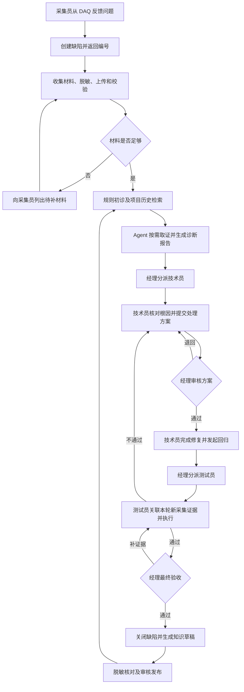

# 采集问题诊断、处理与回归方案

状态：总体方案；自动初诊与 PydanticAI 第一段闭环已实现，具体已做与未做见[本轮实施记录](./本轮实施记录.md)。核对日期：2026/11/09。已追加核对用户指定的当日 DAQ Git 分支与项目平台远端主分支。

入口：[缺陷工作台交互预览](./工作台预览.html) · [业务流程图](./业务流程.svg)。示例数据仅用于讨论展示。

## 结论

目标是先覆盖原有有效能力，再增强。当前平台尚未完整覆盖参考实现，不能宣称已经完成迁移，也不能把“存在模型配置”当作“诊断已验证”。

推荐组合为：**已有规则 + 安全的材料解析与采集工具 + PydanticAI 精简核心 + 项目范围内的可信知识检索 + 人工审核与回归**。只选一种 Agent 框架，避免同一任务叠加多个框架、重复记忆、重复排队或多套角色权限。

## 原实现、当前平台与补齐内容

| 能力             | 157 参考实现                                                                                                                                   | 当前平台                                                              | 本轮建议                                                                              |
| ---------------- | ---------------------------------------------------------------------------------------------------------------------------------------------- | --------------------------------------------------------------------- | ------------------------------------------------------------------------------------- |
| 采集员反馈与建单 | 从 Session / 任务关联建工单，附问题类型、设备和版本上下文                                                                                      | 已有 DAQ 上报、来源校验、账号关联及幂等创建缺陷                       | 工单先可靠落库，再异步补充材料与初诊，重试不重复建单                                  |
| 诊断材料收集     | 固定来源日志、容器日志、版本、最近 recording.log、环境摘要、脱敏 ZIP；新分支另传当前 Session 的 recording.log 与 capture_manifest.summary.json | 已有材料清单、SHA256 校验、私有附件和预览；平台并不自行读取采集机磁盘 | 为每条材料区分“已上传、已校验、已解析、跳过、截断”，默认按当前 Session 和故障时间收集 |
| ZIP 日志分析     | ZIP 被标为 DAQ_LOG，但提取器只接受 log/txt，不展开 ZIP；当日新 DAQ 分支另附独立文本日志及摘要，可被提取，不能说全部诊断材料都被跳过            | 上传接收 ZIP，但诊断只读 log/txt/json/csv/md，同样跳过 ZIP            | 优先修复：受限解包读取、单文件与总量限制、逐文件证据定位；不能照搬原缺口              |
| 规则诊断         | YAML 规则引擎、材料完整性、风险、候选原因和排查建议                                                                                            | 仅超时、连接失败、error/exception 三类文本扫描                        | 逐条盘点迁移规则，增加时间戳、缺帧、节点、版本、磁盘和配置问题的规则及回归样例        |
| 自动初诊         | 问题包与附件提交后自动调度任务                                                                                                                 | 由技术员或经理主动点击诊断，DAQ 上传完成不自动排队                    | 材料就绪后自动触发；保留手动重跑，每次生成不可覆盖的报告版本                          |
| 历史检索         | 已发布可信知识，配置向量检索，失败回退关键词                                                                                                   | 同项目已发布知识的关键词检索                                          | 先保留关键词并补任务/设备/版本/故障指纹筛选；语义检索作为后续增强，不强制新增向量服务 |
| 模型分析         | 规则报告加 RAG + 模型增强；旧 OptionalLlmProvider 类只是桩，不是实际注入路径                                                                   | 单次知识问答式调用；无已发布知识时不能完成模型诊断                    | 受控工具调用、诊断专用结构、证据引用、信息不足明确列待补项，规则报告始终可用          |
| 技术处理与审核   | 根因、方案版本、代码仓库/分支/提交/MR、经理意见与冻结版本                                                                                      | 已有根因、步骤、风险、回滚、仓库/提交及方案审核                       | 增加分支/MR、报告采纳与纠正记录，编辑痕迹及方案差异可查看                             |
| 发起测试与验收   | 技术员发起、经理分派、测试员回归、新采集证据、经理最终验收                                                                                     | 已有方案审批、数据回归、新 Session 证据、经理验收关闭                 | 页面聚合为同一缺陷内的下一步操作，失败和补证据分别返回正确岗位                        |
| 经验沉淀         | 验收后自动生成含根因、处理、验证证据的知识草稿，发布后检索                                                                                     | 数据回归通过也已自动建知识草稿，但正文内容较少、缺陷溯源不完整        | 补全根因/处理/代码版本/审核/回归证据与缺陷直接关联；发布前脱敏核对                    |
| 知识失效         | 工单重开时使相关经验失效                                                                                                                       | 未发现重开缺陷自动使相应知识失效的实现                                | 重开、版本不适用或证据被推翻时标记待复核，从自动诊断候选中排除                        |

当前 ZIP 缺口已通过实际提取函数的合成夹具复现：同一份日志直接上传时读取1份来源、产生3类发现；装入 ZIP 时读取0份来源、产生0条发现。这证明“上传了材料”与“分析读取了材料”必须分开显示。

当前运行实例只读核对：模型配置存在；诊断记录为3条已完成规则任务，未见模型诊断任务；本轮未调用真实模型，也未向模型发送远程日志。

## 开源选型

GitHub 官方 API 实查于2026/11/09，星标随时间变化；能力依据官方 README 和依赖声明，不采用宣传中的速度数字作为本项目测量结果。

| 选型                                                    |   星标 | 许可       | 适用点                                     | 本项目取舍                                                                        |
| ------------------------------------------------------- | -----: | ---------- | ------------------------------------------ | --------------------------------------------------------------------------------- |
| [PydanticAI](https://github.com/pydantic/pydantic-ai)   | 21,097 | MIT        | 类型化工具、结构化报告、依赖注入和输出校验 | 首选精简安装，按需启用一种模型接口，不引入整套 Harness、Web UI 或另一套业务管理   |
| [smolagents](https://github.com/huggingface/smolagents) | 30,269 | Apache-2.0 | 核心简洁，工具调用容易试验                 | ToolCallingAgent 作为轻量备选；本场景不默认使用模型生成 Python 并执行的 CodeAgent |
| [Agno](https://github.com/agno-agi/agno)                | 43,112 | Apache-2.0 | 工具、知识、会话及团队编排较完整           | 需要独立 Agent 服务产品时可考虑；当前不引入 AgentOS 再建一套后台                  |
| [LangGraph](https://github.com/langchain-ai/langgraph)  | 44,677 | MIT        | 长流程状态、持久化、暂停恢复和人工介入     | 长期备选；现有后台队列和审批已承担这些职责，首期不重复建设                        |

**版本兼容不能跳过。** 当前后端固定 `openai==1.63.2`。本次检索到的 PydanticAI 主分支精简包模型扩展要求 `openai>=3.31.0`，Agno 主分支模型扩展要求 `openai>=1.106.0`；不能把未发布主分支依赖直接当作可安装稳定版，也不能直接覆盖当前环境。

落地前必须核对选定稳定发行版的依赖：优先采用独立诊断 worker 环境固定依赖，由原平台传递任务和受控材料引用；如果要同环境接入，先在隔离副本验证全部依赖及现有问答回归。没有兼容验证，不直接安装最新版。

smolagents 当前主分支模型扩展约束为 `openai>=1.58.1`，与当前固定版本的这一条约束相容，但这不等于全部依赖和实际模型协议已验证。

## 增强哪些分析能力

1. **读全正确材料**：ZIP 内文本、manifest、采集与容器日志按时间关联；展示实际读取范围，避免只分析描述。
2. **先规则后按需取证**：初诊后由 Agent 调用白名单工具查指定日志片段、版本摘要和采集状态；缺材料时一次列清楚。
3. **面向故障的报告**：观察事实、候选根因、支持与反证、排查步骤、临时处理、风险及待验证项。
4. **复用可信历史**：结合项目、设备型号、软件版本和故障特征，显示相似与不相似之处；失败经验也保留，避免重复尝试。
5. **将人处理结果反哺**：技术员采纳/纠正，经理审核，测试验证后形成知识草稿；审核发布后才用于后续自动诊断。
6. **自动衔接而非自动拍板**：自动收集、排队、生成报告和提醒；责任指派、方案审批、回归验收与关闭由相应人员完成。

不建议首期拆成多个互相对话的 Agent。先用一个诊断 Agent 配多个可审计工具；以后只有“单次无法覆盖材料”的场景，才增加独立材料解析任务或复核任务。

### 采集电脑与机器人范围

平台不直接遍历采集电脑或机器人磁盘，也不自动读取全部部署源码。采集端执行固定的只读采集接口：部署版本、进程/容器摘要、脱敏配置、驱动和传感器状态、通信情况及故障时间窗口内日志。源码分析定位到该部署版本的可信仓库片段；没有源码时明确“无法对照代码”。

机器人诊断需要已有接口或日志提供故障码、驱动/传感器状态。连接超时只支持“通信异常”的判断，不能直接确认硬件损坏。运动控制、改配置、重启设备和执行任意命令不属于自动诊断工具。

## 流程与状态

一条来源问题只建一条缺陷；上传、诊断、补材料、处理与回归都关联这一条记录。业务状态沿用“待处理、处理中、待回归、已关闭”，详细工作环节和诊断任务状态单独记录，避免出现多个互相矛盾的状态按钮。

Agent 不可用、超时或材料不足不阻止已建缺陷进入人工处理。规则结果、模型报告、人工判断分开记录。

## 网页展示与操作

### 缺陷列表

保留日常列表，不把整份报告塞进每一行。展示：缺陷编号与标题、业务状态、严重程度、负责、上报人、来源和更新时间。诊断列只显示“待材料/分析中/已生成/失败”等任务摘要；点击摘要直达同一缺陷的诊断页签。待补材料显示数量，不使用大段解释。

同一行点击负责或严重程度可调整；只读账号不出现可编辑外观。筛选增加诊断状态、待我处理、待我补充、来源设备和版本；沿用分页与每页数量。

### 缺陷工作台

头部固定显示编号、标题、业务状态和当前环节；右上角仅放当前角色最需要的一个主操作，“更多”中放转派、归并、归档等次要操作。

页签为 **概况 / 诊断 / 处理方案 / 回归测试 / 操作记录**：

| 区域     | 默认展示                                                        | 深入查看                                                        |
| -------- | --------------------------------------------------------------- | --------------------------------------------------------------- |
| 概况     | 问题描述、来源任务/Session、上报人、设备/版本、最近结论与下一步 | 原始来源上下文、归并及历史工单                                  |
| 诊断     | 最新报告摘要、结论依据级别、待验证项、材料完整性和任务进度      | 候选原因、逐条证据、相似案例、读取范围、模型/规则版本与历史报告 |
| 处理方案 | 根因、修复步骤、风险、验证方法、对应代码变更和当前审核意见      | 方案版本对比、过往退回原因、报告采纳或纠正                      |
| 回归测试 | 当前轮次、负责、环境、版本、执行结果、实际证据和经理验收        | 前轮对比、关联 Session/附件、失败与重新采集记录                 |
| 操作记录 | 谁在何时做了什么、前后状态、说明，按时间分页                    | 可跳转到当时冻结的报告/方案/回归版本                            |

诊断摘要说明“待验证”“证据充分”或“信息不足”；未经评估校准，不显示模型猜测的百分比作为真实正确率。点证据能打开对应文件与行号；长日志在阅读区滚动，可下载。报告必须可查看上一版，重跑不覆盖。

### 各角色下一步

| 环节         | 角色       | 主操作              | 完成后                         |
| ------------ | ---------- | ------------------- | ------------------------------ |
| 材料不足     | 上报采集员 | 补充材料            | 原缺陷重新校验，不再建单       |
| 新缺陷       | 项目经理   | 分派                | 技术员收到待办                 |
| 初诊或处理中 | 技术员     | 开始处理 / 保存方案 | 保存草稿，便于继续编辑         |
| 方案就绪     | 技术员     | 提交审核            | 冻结本版并提醒经理             |
| 等待方案审核 | 项目经理   | 审核方案            | 通过或带原因退回               |
| 修复完成     | 技术员     | 发起回归            | 生成关联测试计划，提醒分派     |
| 回归待分派   | 项目经理   | 分派测试            | 仅选有效项目测试成员           |
| 回归执行     | 测试员     | 提交测试结果        | 不通过回技术员；通过待经理验收 |
| 结果待验收   | 项目经理   | 验收                | 补证据返回原测试员，通过后关闭 |
| 已关闭       | 有权限人员 | 查看处理结果        | 经理可填写原因重开             |

管理员可以兼任这些职责，但页面当前操作由记录实际分派与项目权限决定，不把平台管理员身份等同于这条缺陷的负责。

### 异常与防误解

- 材料失败：保留已建编号及成功文件，明确失败项，支持只重传失败文件。
- 分析失败：保留规则报告与已读取范围；重试生成新报告。不能显示“诊断完成”却没有证据。
- 尚无知识：仍可做事实提取和规则扫描；模型只给带当前材料证据的候选原因，不编造历史。
- 方案退回：回技术员。经理仅要求补回归证据时：回原测试员。按钮文案与处理对象一致。
- 回归失败：新修复轮次保持原缺陷编号，冻结并保留旧方案与旧证据。
- 重开：相关知识标记待复核，不再自动推荐为已验证解决方案。

## 布局与视觉

沿用平台现有中文字体、白色内容卡和蓝绿色强调色。文字正文13–14像素，标题18–20像素，次要元数据11–12像素；交互文字与普通说明有明确差别。状态同时使用文字与颜色，不只依赖颜色。

按内容区实际宽度布局：1100像素以上为正文与280–320像素属性栏；中等宽度收起或移动属性；700像素以下单栏。边距16–24像素，不整页固定限宽造成巨大左右空栏。正文不为了撑满视口加入空卡或拉高活动框。

报告先摘要再证据，原始日志与高级参数按需展开。工具条允许换行，长表格局部滚动；评论框空时约44像素，长输入限制高度，提交按钮保持可见。

交互预览包含角色切换、工作环节示例、诊断状态、不同页签和完整流程，不会连接真实业务接口。

## 提升预估与验收

此前提出“排查时间减少20%–30%、命中提高10–20个百分点”只能作为实验目标，当前没有基线数据支撑其实现概率，不能作为承诺或已取得的提升。

| 维度         | 目前可确认                                        | 首轮验收方式                                                                           |
| ------------ | ------------------------------------------------- | -------------------------------------------------------------------------------------- |
| ZIP 内容覆盖 | 合成样例中当前解析为0；原始文本为1个来源、3类发现 | 支持的受限 ZIP 样例全部读到预期文件和行号；危险包全部拒绝                              |
| 规则覆盖     | 当前只有3类扫描，尚未盘点齐参考规则               | 以参考规则清单逐条对应；保留输入、预期和回归证据                                       |
| 自动初诊链路 | 当前未自动触发                                    | 每份就绪材料只触发一次，断网/失败重试不重复建单；全部状态准确回显                      |
| 根因建议质量 | 未做同模型、同案例比较                            | 至少50个、最好100个已知根因案例；固定模型与预算，分训练历史与未见测试集                |
| 命中目标     | 尚未测量                                          | 比较Top1/Top3根因命中率、错误引用率和无依据肯定结论率；提升10–20个百分点仅为待验证目标 |
| 使用效率目标 | 尚未测量                                          | 由技术员同口径记录排查用时；减少20%–30%仅为待验证目标                                  |
| 可操作性     | 现有多个面板和手动诊断入口                        | 每个角色能从缺陷直接完成下一步；错误权限被前后端同时拒绝                               |

第一阶段先修材料链路与规则覆盖；第二阶段接入一个受控 Agent；第三阶段补知识复用与网页闭环；最后在固定案例集和真人任务上验证效果。框架星标不能替代这套验收。

## 核对来源

157 只读参考（此前工作副本）：项目服务分支 `delivery/project-hub-5090-20261109`，提交 `092a833bae930dbaccc042b8db645bb2c8f8baa5`；DAQ 部署副本提交 `80d363018ca9c126894f66a7c45c591ae453d4d3`，存在本地改动；数据平台分支 `feat/knowledge-governance-rag-local`，提交 `50726e9eb88e1e7433dd87bf0f33549af735c120`，存在本地改动。本轮未写入157。

当前代码核对：`ProjectServer/plane/quality/{daq,diagnostics,tasks,attachments,solutions,data_regression}.py`、`ProjectServer/plane/knowledge/{assistant,retrieval}.py`，以及当前缺陷与诊断面板。

官方依赖说明：[PydanticAI精简包](https://github.com/pydantic/pydantic-ai/blob/main/pydantic_ai_slim/pyproject.toml)、[smolagents](https://github.com/huggingface/smolagents/blob/main/pyproject.toml)、[Agno](https://github.com/agno-agi/agno/blob/main/libs/agno/pyproject.toml)、[LangGraph](https://github.com/langchain-ai/langgraph)。

### 当日指定 Git 分支补充核对

- DAQ：`feat/daq-project-hub-bridge-agent-20261109`，提交 `f4f621caf4642c4aee60fdacbaea990b51b3c090`，作者 liyating，2026/11/09 15:07:30 +08:00。
- 项目平台远端默认分支：`93572d274678d10a3cff8d9c90f7800dd6689612`，2026/11/09 11:10:14 +08:00。
- 新 DAQ 在 `createDiagnosisPackage` 中组合独立 Session 材料和诊断 ZIP，并传录制缺失项、事实与 topic 差异。Agent 的规则/模型仍在项目服务执行，DAQ 做本地基础检查及材料供给。
- 项目平台当前提取器仍只读取独立日志和 manifest，不展开 ZIP。本方案将独立材料可解析与 ZIP 内材料未解析分开说明。新分支源码核对不等于已在设备上跑通联调。

[指定 DAQ 分支](https://git.transcengram.com/engram_data/engram_DAQ/src/branch/feat/daq-project-hub-bridge-agent-20261109) · [项目平台仓库](https://git.transcengram.com/EngramProjectManagement/Engram_Project_HUb)
