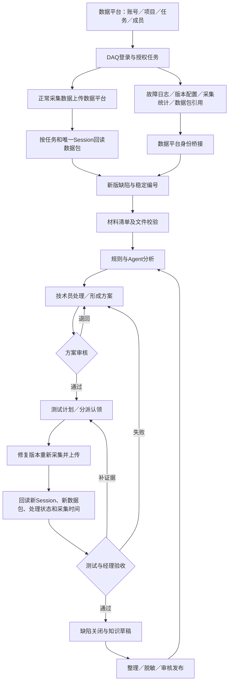

# 三平台覆盖与改进核对

核对日期：2026/11/09。本文区分源码能力、自动化检查、本机运行验证和真实现场验收。仅更新独立副本，不修改157及本机原数据平台。

## 核对版本

| 来源 | 分支／提交 | 本轮核对范围 |
|---|---|---|
| 数据平台 | feat/project-hub-account-project-bridge-20261109；58c79438904cb07b788a6e476be44266be35c845 | 项目任务成员目录、Trusted Identity代理、权限、Session与数据包上下文 |
| DAQ | feat/daq-project-hub-bridge-agent-20261109；f4f621caf4642c4aee60fdacbaea990b51b3c090 | 上传流程、诊断材料、登录与异常入口、状态回查 |
| 旧项目平台 | main；93572d274678d10a3cff8d9c90f7800dd6689612 | 目录镜像、来源工单、方案审核、回归、Agent与知识 |
| 用户交付说明 | Project-Hub账号项目桥接.md；数据平台与DAQ桥接配置交付说明.md；Project-Hub异常闭环配置与交付说明.md | 作为合同与边界依据；说明自身明确公司目标环境完整闭环未验证 |

说明中的旧项目平台交付提交为092a833，和当前main不同。本文以本次取到的明确提交为源码依据，不把旧文档的测试数当作新版验证结果。

## 职责和事实来源

- 数据平台负责账号启停、外部用户ID、项目、任务、成员、采集员归属、数据包和上传处理状态。
- DAQ负责采集Session、现场故障信息、上传任务及诊断材料；浏览器不能自行声明可信角色和项目。
- 当前项目平台保存跨平台映射、项目业务权限、需求与任务、缺陷、测试、诊断报告、技术方案、审核回归及知识。
- 业务编号用于交流和定位；外部项目ID、任务ID、唯一Session和数据包ID用于来源核实。两者分别保存，不能互换。
- 诊断上报不重复上传MCAP、视频或完整Session；原采集数据仍按DAQ到数据平台的原流程传输。

这是多个工作流中的三平台故障场景图，不代替项目、需求、版本迭代、用例管理、报表、权限和页面体验的完整验收。

## 按能力对照

| 能力 | 旧平台实现 | 新版现状 | 增强／缺口 |
|---|---|---|---|
| 项目来源 | PlatformCatalogMirrorService读取数据平台项目、任务、成员；管理员触发同步 | catalog.py读取同一目录合同，保存来源快照，显式导入任务 | 已有增量与全量核对、分页搜索、来源停用撤销；全局发现未映射项目并创建新版项目的入口未补齐 |
| 项目ID关系 | 外部项目ID与RTP映射独立 | PlatformProject将外部项目ID映射原生项目UUID | 保留原生短项目标识和历史关联，不信任前端名称 |
| 用户和权限 | 数据平台代理生成Trusted Identity V2，项目平台再核验 | 签名、时效、nonce、权限回读及未登录数采员首次关联均有检查 | 新版支持同人多业务职责；全新DAQ分支经新代理到新版的完整HTTP验收未完成 |
| 工单来源 | taskId+sourceRecordId重新查权威数据包；名称仅唯一回退 | 原任务、精确Session、包ID和项目映射核对 | 不在来源不明时猜项目；重试前重新核权 |
| DAQ普通数据上传 | init/chunk/complete；complete可仅代表Transferring | 采集数据继续留在原流程，项目平台只存引用 | 新分支新增dataPackageStatus/dataReady；新版收到明确未就绪标记时禁止将其用于通过验收 |
| 异常材料 | schema/manifest摘要、录制日志摘录、诊断ZIP | 校验文件大小与SHA256，受控读取ZIP内部文本 | 原始附件与分析读取、网页预览分层；正在明确截断及缺失项 |
| 环境材料 | 已有系统、GPU、磁盘、Docker及版本摘要 | 可读取并引用 | DAQ独立新分支增加启动时和报告时环境观察；尚未部署现场 |
| 自动诊断 | DAQ创建问题包后触发旧服务规则/RAG/可选模型 | 文件验证后自动分析，规则保留、PydanticAI受控工具、版本历史 | 已实际模型后台队列成功；等待材料不空跑，最新成功报告与失败重试区分 |
| 原诊断规则 | 4个YAML文件共12项规则 | 4文件SHA256逐项一致；解释执行条件 | 源摘要是待验证事实；不是所有规则都有完整上传字段，不能宣称同等诊断效果 |
| 模型诊断 | 原服务RAG+可选LLM | 同项目知识、证据引用、结构化建议与验证 | 单个受控样例成功不等于准确率基准；已修正timeout=1参数触发超时误判 |
| 材料范围 | 有界、脱敏、不传原始MCAP视频 | 单文件读取256KiB、总1MiB，模型输入与预览再限长 | 不把限制内读取称为电脑全部资料；原始大数据不重复传项目平台 |
| 技术方案 | 根因、步骤、验证、风险回滚、仓库、分支与提交等 | 原生方案版本、审核快照、根因、修复步骤、验证、风险回滚、仓库提交 | 分支/MR字段及研发变更关联尚未完全对齐 |
| 发起测试 | 技术员/经理发起方案对应回归并分派测试员 | 原生受管计划、分派认领、执行、审核及多轮 | 普通测试与新数据回归分别保留，不混合状态 |
| 回归数据 | 从数据平台回读任务、Session、包、采集时间 | verified_context核对原任务、本轮新包、新时间、来源未停用 | 经理验收再次回读，发现归属或内容变化阻断关闭；新ready字段不是旧接口均已有 |
| 状态反馈 | DAQ查询来源工单、报告和回归历史 | 原生DAQ详情/来源历史返回当前状态及回归 | UUID原生合同与旧数值ID合同不同，最新DAQ前端适配与错误透传全链路仍须补验 |
| 回归失败 | 原工单重开并进入下一修复轮次 | 缺陷和计划有多轮及退回能力 | 新数据回归失败自动重开原缺陷的完整行为仍需专项补验，不能仅看按钮认为覆盖 |
| 知识积累 | 验收通过自动生成结构化知识，重开使旧知识失效 | 新版能生成草稿、整理脱敏、审核发布、同项目检索 | 草稿尚缺部分方案结构和缺陷关联；重开失效联动、源知识迁移未完成 |
| 语义检索 | 原服务可配置Embedding+Qdrant并回退关键词 | 当前主要为项目内已发布关键词检索 | 向量/RAG能力与历史案例储备未完全迁移，不宣称更高准确率 |
| 稳定业务编号 | 原Plane工作项项目序号；禅道各业务稳定ID | 缺陷D、用例C、计划P、用例集S、执行E等统一生成；原需求R保留 | 并发分配、重试原编号、旧数据补号、编号查询定位已实现 |
| 报告优先级 | 历史报告可查询 | 当前报告独立、历史折叠；同材料失败保留成功模型报告 | 不同材料不自动复用旧结论，诊断报告版本与缺陷状态分开 |
| 真实现场验收 | 文档明确仍待公司三平台验收 | 本机受控数据和真实模块运行材料已验证部分 | 物理机器人、最新DAQ完整登录上传桥接和公司目标部署未验收 |

## 本轮独立分支

- DAQ：feat/diagnostic-evidence-context-20261109，基于指定f4f621；增加源数据引用与启动/当前环境摘要。没有修改现场DAQ。
- 数据平台：feat/diagnostic-source-readback-20261109，基于58c794；只读上下文新增处理状态、dataReady和采集统计。没有修改157或本机原数据平台。
- 项目平台：/home/engram/Documents/EngramProject，统一编号、报告主次、材料范围及回归终态检查在此修改。

## 建议的完成次序

1. 完成本轮报告/编号/材料范围与独立分支的验证。
2. 将最新DAQ前端与数据平台Bridge合同接入新版原生API，补真实登录后的来源核验、附件、诊断和状态回查。
3. 补无Session启动故障入口：先核实当前账号和设备/任务授权，不伪造数据包。当前尚无完整上线入口。
4. 全局来源项目发现与安全关联、上传终态回读、回归失败回修复及再次验收，分别写验收记录。
5. 只读导出157知识、版本与附件清单，按项目映射和审核状态导入，核对数量/哈希/引用；不是仅复制源码。
6. 结构化经验草稿、根因修复证据和知识失效联动，再评估语义检索。
7. 同时继续全平台页面、权限、状态、分页、文档与旧新入口核对，不用三平台场景替代其他模块。
